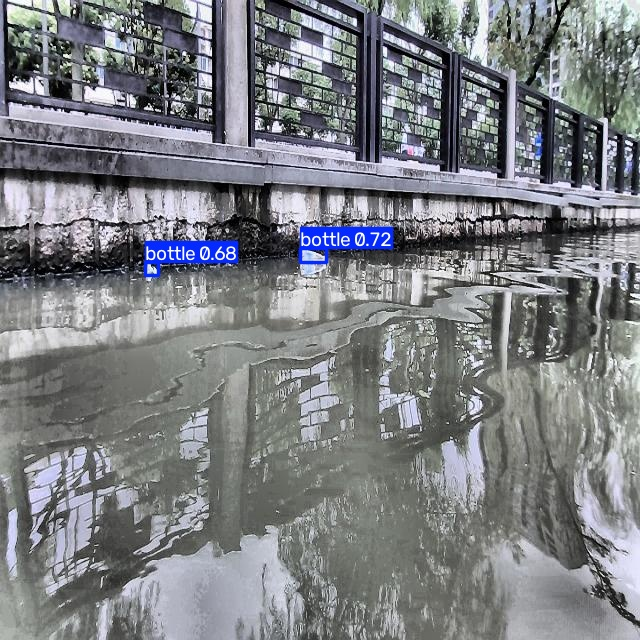
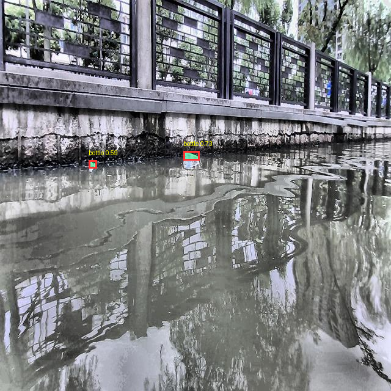
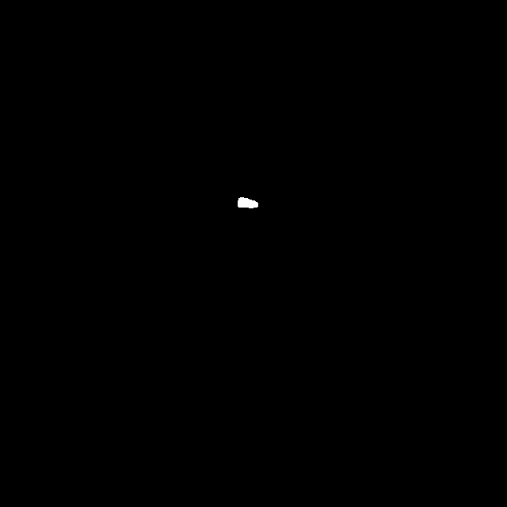
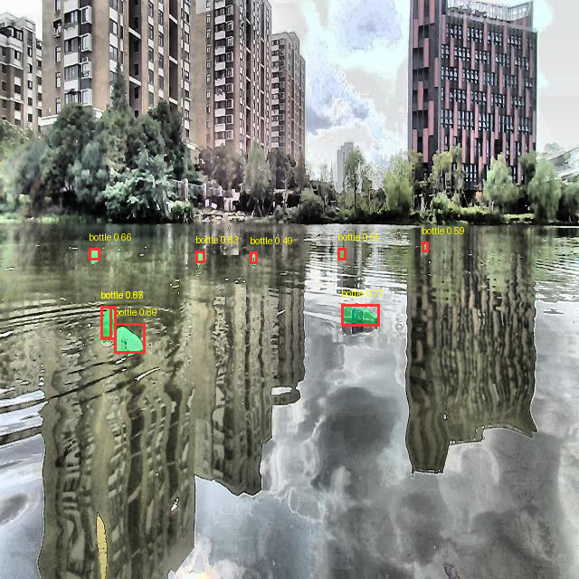
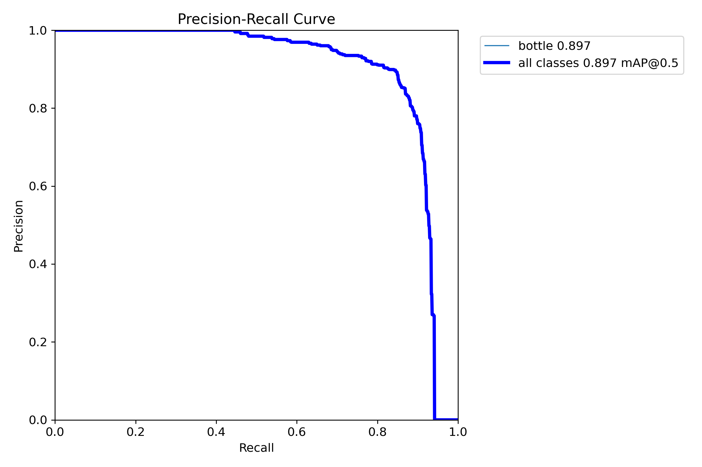
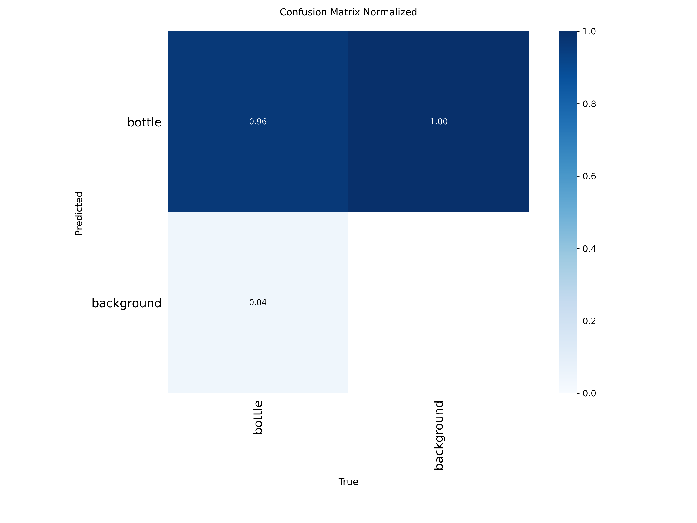
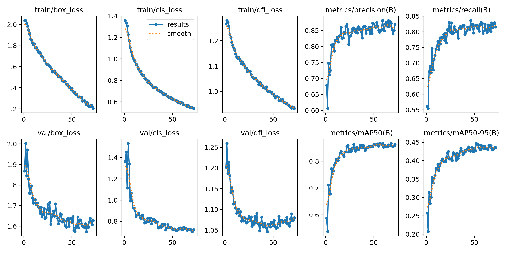
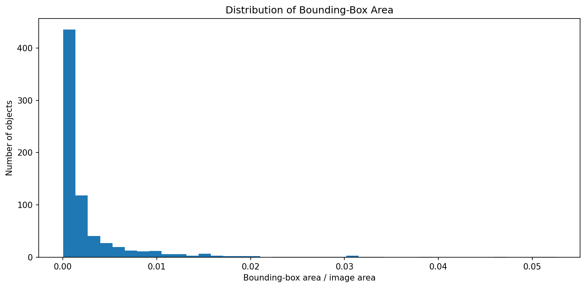
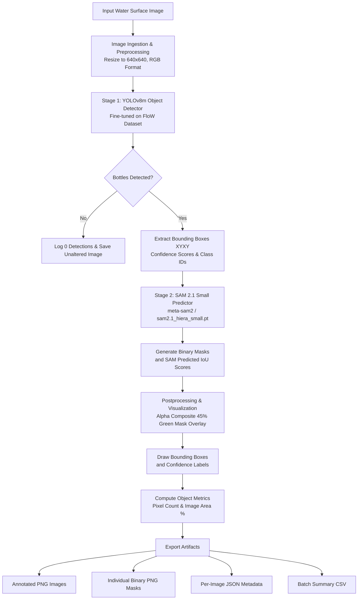

# Plastic Waste Detection on Water Bodies Using Deep Learning

[](https://www.python.org/)
[](https://github.com/ultralytics/ultralytics)
[](https://github.com/facebookresearch/sam2)
[](https://pytorch.org/)
[](https://colab.research.google.com/)
[](LICENSE)
[](https://creativecommons.org/licenses/by/4.0/)

> **A two-stage computer vision system integrating fine-tuned YOLOv8m object detection with Segment Anything Model 2.1 (SAM 2.1 Small) bounding-box prompted zero-shot segmentation for detecting and isolating floating plastic bottles in aquatic environments.**

<!-- Add project banner at assets/banner.png -->

---

## 📌 Table of Contents

- [Overview](#-overview)
- [Problem Statement](#-problem-statement)
- [Proposed Solution](#-proposed-solution)
- [Key Features](#-key-features)
- [Visual Results](#-visual-results)
  - [Detection & Segmentation Pipeline Samples](#detection--segmentation-pipeline-samples)
  - [Detector Performance & Training Dynamics](#detector-performance--training-dynamics)
- [System Architecture](#-system-architecture)
- [Dataset Description](#-dataset-description)
- [Repository Structure](#-project-folder-structure)
- [Technology Stack](#-technology-stack)
- [Installation & Setup](#-installation-and-setup)
  - [Google Colab Workflow](#1-google-colab-workflow-recommended)
  - [Local Environment Setup](#2-local-environment-setup)
- [Model Usage & Pipeline Inference](#-model-usage-and-inference)
- [Training & Evaluation](#-training-and-evaluation)
  - [YOLOv8m Training Details](#yolov8m-training-details)
  - [Quantitative Detector Test Metrics](#quantitative-detector-test-metrics)
- [Generated Output Artifacts](#-generated-output-artifacts)
- [Performance & Limitations](#-performance-and-limitations)
- [Security & Responsible Use](#-security-and-responsible-use)
- [Future Enhancements](#-future-enhancements)
- [Contributing](#-contributing)
- [License](#-license)
- [Acknowledgements](#-acknowledgements)
- [Contact](#-contact)

---

## 🌊 Overview

Plastic pollution in rivers, lakes, canals, and coastal water bodies is an escalating environmental catastrophe. Millions of tons of post-consumer plastic debris enter aquatic ecosystems annually, posing severe threats to aquatic wildlife, degrading drinking water reservoirs, and breaking down into hazardous microplastics that enter the human food web.

Manual environmental surveys and physical clean-up tracking across large waterways are labor-intensive, hazardous, and difficult to scale. Automated visual surveillance using computer vision provides a scalable, repeatable way to monitor water surfaces and track macro-debris.

This project implements a **two-stage modular computer vision pipeline**:
1. **Object Detection via YOLOv8m:** Rapidly identifies, localizes, and bounds floating plastic bottles against complex water surfaces.
2. **Instance Segmentation via SAM 2.1 Small:** Accepts YOLO-predicted bounding boxes as spatial geometric prompts to produce pixel-level binary masks isolating the exact morphology of each bottle.

By combining an object detector with a zero-shot foundation segmenter, the pipeline achieves tight localization without requiring labor-intensive manual polygonal mask annotations during model training.

> [!NOTE]
> This system is developed as an academic and educational research prototype for a final-year B.Tech in Computer Science and Engineering. It is not an industrial production monitoring appliance.

---

## 🎯 Problem Statement

Detecting plastic waste in water bodies via standard vision systems presents several open computer vision challenges:

- **Reflections and Specular Glare:** Sunlight reflecting off moving water ripples creates bright highlights that resemble transparent or shiny plastic surfaces.
- **Turbidity and Submersion:** Floating debris is frequently semi-submerged, water-logged, or coated with algal growth, obscuring distinct plastic silhouettes.
- **Scale and Viewpoint Variations:** Debris appears at drastically differing camera ranges—from large foreground objects to small clusters of a few pixels drifting near the horizon.
- **Dynamic Backgrounds:** Flowing currents, foaming water, shoreline detritus, wave patterns, and aquatic vegetation introduce complex background clutter.
- **Partial Occlusion:** Bottles frequently overlap with riverbanks, organic debris (twigs, leaves), or other trash items.

---

## 💡 Proposed Solution

The system addresses these challenges through a two-stage coarse-to-fine visual pipeline:

```
┌─────────────────┐       ┌──────────────────────┐       ┌──────────────────────┐
│   Input Image   │ ────> │ Preprocessing (640)  │ ────> │  YOLOv8m Detection   │
└─────────────────┘       └──────────────────────┘       └──────────┬───────────┘
                                                                    │ Predicted Boxes
                                                                    ▼
┌─────────────────┐       ┌──────────────────────┐       ┌──────────────────────┐
│  Saved Outputs  │ <──── │ Visual Overlay & CSV │ <──── │ SAM 2.1 Small Mask   │
│ (PNG/JSON/CSV)  │       │   Metadata Logger    │       │ Prompted by YOLO Box │
└─────────────────┘       └──────────────────────┘       └──────────────────────┘
```

1. **Input Ingestion & Preprocessing:** Reads RGB water surface imagery, standardizes color spaces, and resizes to 640×640 resolution.
2. **YOLOv8m Detection:** The fine-tuned YOLOv8m detector scans the image and outputs bounding boxes `[x1, y1, x2, y2]`, confidence scores, and class predictions.
3. **Prompt Formulation:** High-confidence bounding boxes are extracted and formatted as 2D spatial box prompts for Segment Anything Model 2.1.
4. **SAM 2.1 Small Segmentation:** Meta's `SAM2ImagePredictor` takes the image embeddings and box prompts to generate high-resolution binary segmentation masks and mask quality scores (`sam_predicted_iou`).
5. **Mask Postprocessing & Annotation:** Individual object masks are composited into a color overlay (45% green alpha tint), bounding boxes are drawn, and per-object pixel counts and image area percentages are computed.
6. **Artifact Persistence:** Saves annotated images, individual binary masks, detailed JSON object metadata, and consolidated CSV reports.

---

## ✨ Key Features

- **Single-Class Specialization:** Fine-tuned specifically for floating `bottle` instances (Class ID `0`).
- **Two-Stage Modular Architecture:** Decoupled detection (YOLOv8m) and segmentation (SAM 2.1 Small), allowing each model to be upgraded independently.
- **Box-Prompted Zero-Shot Segmentation:** Obtains detailed object masks using bounding-box prompts without requiring pixel-level polygon training labels.
- **CPU-Optimized End-to-End Inference:** Pipeline integration notebooks (`05_SAM21_Integration.ipynb` and `06_End_to_End_Testing.ipynb`) are designed to execute reliably on standard CPU hardware.
- **Structured Data Export:** Automatically exports detection outputs to structured per-image JSON files and batch-level CSV tables.
- **Comprehensive Notebook Suite:** Six fully executed, documented Jupyter notebooks covering dataset setup, health audits, training, evaluation, integration, and batch testing.

---

## 🖼️ Visual Results

### Detection & Segmentation Pipeline Samples

Below are sample outputs generated by the pipeline on test water images from the Roboflow dataset:

| Stage / Result Type | Output Preview | Description |
|---|:---:|---|
| **YOLOv8m Detection** |  | YOLOv8m detector bounding boxes (`bottle 0.72`, `bottle 0.68`) on water canal surface. |
| **End-to-End Segmentation** |  | Two-stage result showing red bounding boxes, yellow confidence labels, and green alpha-blended SAM masks. |
| **Extracted Binary Mask** |  | Individual isolated binary mask (`255` foreground, `0` background) for Object 1. |
| **Multi-Object Scene** |  | Segmented multi-bottle scene on open water with reflections and shoreline buildings. |

### Detector Performance & Training Dynamics

| Metric Curve / Diagnostic | Plot | Description |
|---|:---:|---|
| **Precision-Recall Curve (Test)** |  | Precision-Recall curve evaluated on the 200-image test set (**mAP@0.5 = 0.897**). |
| **Normalized Confusion Matrix** |  | Evaluated test set matrix showing 96% true positive bottle detection rate against background. |
| **YOLOv8m Training Progression** |  | Loss curves (box, cls, dfl) and validation metrics across 72 training epochs. |
| **Bounding Box Area Distribution** |  | Dataset distribution of bounding-box relative areas, highlighting prevalence of small floating objects. |

---

## 🏗️ System Architecture

The end-to-end detection and segmentation pipeline operates in two sequential stages:



### Model Responsibilities

| Component | Architecture / Variant | Device | Primary Role |
|---|---|:---:|---|
| **Detector** | YOLOv8m (`yolov8m_best.pt`, 52 MB) | CPU / GPU | Scans images to localize floating bottles and outputs bounding boxes `[x1, y1, x2, y2]`. |
| **Segmenter** | SAM 2.1 Small (`sam2.1_hiera_small.pt`, 184 MB) | CPU | Consumes YOLO bounding boxes as geometric prompts to generate exact pixel-level masks. |

---

## 📂 Project Folder Structure

The repository is organized into distinct directories for notebooks, datasets, model checkpoints, experimental results, and generated inference outputs:

```text
identification of plastic waste/
├── dataset/                               # Dataset metadata and Roboflow documentation
│   ├── README.dataset.txt                 # FloW dataset citation and Roboflow Universe link
│   ├── README.roboflow.txt                # Roboflow export info, preprocessing, augmentations
│   ├── data.yaml                          # Initial dataset configuration
│   └── test/                              # Local test sample images and labels
├── models/                                # Trained and downloaded model weights
│   ├── yolov8m_best.pt                    # Fine-tuned YOLOv8m checkpoint (52.0 MB)
│   └── sam2/                              # SAM 2.1 checkpoint directory
│       └── sam2.1_hiera_small.pt          # Meta SAM 2.1 Hiera Small checkpoint (184.4 MB)
├── notebooks/                             # Completed end-to-end Jupyter notebooks
│   ├── 01_Dataset_Setup.ipynb             # Environment setup and directory initialization
│   ├── 02_Dataset_Inspection.ipynb        # Dataset health inspection and class distribution
│   ├── 03_YOLOv8m_Training.ipynb          # YOLOv8m model fine-tuning (72 epochs)
│   ├── 04_Detector_Evaluation.ipynb       # Comprehensive evaluation on 200 test images
│   ├── 05_SAM21_Integration.ipynb         # YOLOv8m + SAM 2.1 integration on CPU
│   └── 06_End_to_End_Testing.ipynb        # Full batch pipeline execution and metrics export
├── outputs/                               # Generated pipeline inference outputs
│   ├── detections/                        # Output folder for raw detection visualizations
│   ├── masks/                             # Intermediate mask directory
│   ├── visualizations/                    # Additional visualization outputs
│   ├── yolov8m_test_predictions/          # Detector test predictions on 200 images
│   ├── sam21_integration/                 # Multi-bottle integration test outputs
│   │   ├── 000001_..._segmented.png       # Annotated composite image
│   │   ├── 000001_..._combined_mask.png   # Combined binary mask
│   │   └── 000001_..._metadata.json       # Detection metadata JSON
│   └── end_to_end/                        # Batch testing inference results
│       ├── annotated/                     # Segmented overlay images
│       ├── masks/                         # Individual binary mask PNGs per object
│       ├── metadata/                      # Per-image detection JSON files
│       ├── end_to_end_results.csv         # Consolidated table of detected objects
│       └── run_report.json                # Execution metadata and summary
├── results/                               # Training metrics, plots, and corrected configs
│   ├── data_corrected.yaml                # Verified absolute-path dataset configuration
│   ├── dataset_setup_report.json          # Setup audit report
│   ├── metrics/                           # CSV and JSON metrics reports
│   │   ├── dataset_health_summary.csv     # Dataset integrity summary
│   │   ├── yolov8m_test_metrics.csv       # Test evaluation metrics table
│   │   └── yolov8m_test_report.json       # Quantitative evaluation JSON report
│   ├── plots/                             # Data distribution and training plots
│   │   ├── bbox_area_distribution.png     # Bounding box area histogram
│   │   ├── class_distribution.png         # Single-class frequency plot
│   │   └── dataset_bbox_samples.png       # Sample bounding box visual check
│   ├── yolov8m_training/                  # Training logs, curves, and weights
│   │   └── plastic_bottle_yolov8m/        # 72-epoch training run artifacts
│   │       ├── args.yaml                  # Exact training hyperparameters
│   │       ├── results.csv                # Epoch-by-epoch loss & validation metrics
│   │       ├── results.png                # 10-panel training progression plot
│   │       └── BoxPR_curve.png            # Validation PR curve
│   └── yolov8m_evaluation/                # Test split evaluation curves
│       └── test_metrics/                  # Detailed test diagnostic plots
├── backend/                               # Optional FastAPI web service & inference API
│   ├── app/                               # API routes, core configs, inference services
│   └── requirements.txt                   # Backend Python dependencies
├── frontend/                              # Optional React / Vite web interface
├── .gitignore                             # Ignored virtual environments, checkpoints & artifacts
└── README.md                              # Project documentation
```

> [!NOTE]
> Heavy model weights (`*.pt`) and full raw dataset image folders (`train/` and `valid/`) are stored locally or in Google Drive and excluded from Git commits via `.gitignore`.

---

## 📊 Dataset Description

The system was trained and evaluated using the **FloW (Floating Waste)** dataset formatted for YOLO object detection, exported via Roboflow Universe.

- **Dataset Source:** [FloW on Roboflow Universe](https://universe.roboflow.com/waste-detection-zxduh/flow-9dt9s-ysldg/dataset/1)
- **License:** Creative Commons Attribution 4.0 International ([CC BY 4.0](https://creativecommons.org/licenses/by/4.0/))
- **Original Research Citation:** Cheng et al., *"FloW: A Dataset and Benchmark for Floating Waste Detection in Inland Waters"*, IEEE/CVF ICCV 2021.
- **Classes:** Single class: `bottle` (Class index `0`).
- **Annotation Format:** Standard YOLO normalized coordinates:
  ```text
  <class_id> <x_center> <y_center> <width> <height>
  ```
  Where all coordinates are normalized floats in the range `[0.0, 1.0]` relative to image width and height.

### Dataset Split Distribution

| Split | Image Count | Image Resolution | Annotation Status |
|---|:---:|:---:|---|
| **Train** | 4,202 | 640×640 | Fully annotated (2 images lacked corresponding label files during audit) |
| **Validation** | 401 | 640×640 | Fully annotated (1 image lacked corresponding label file during audit) |
| **Test** | 200 | 640×640 | Fully annotated (200 images, zero missing labels) |
| **Total** | **4,803** | **640×640** | **Single-class: `bottle`** |

### Preprocessing & Augmentation Pipeline
- **Preprocessing:** Auto-orientation of pixel data, stretch resizing to 640×640, and adaptive contrast equalization.
- **Training Augmentations:** 50% horizontal flip probability, random rotation between -15° and +15°, random brightness adjustment (±15%), random Gaussian blur (0–1.3 px), and Mosaic augmentation.

### Corrected Dataset Configuration (`results/data_corrected.yaml`)
```yaml
path: /content/drive/MyDrive/deeplearning/Dataset/Dataset_for_yolo
train: train/images
val: valid/images
test: test/images
nc: 1
names:
  - bottle
```

---

## 💻 Technology Stack

| Category | Technology / Library | Version / Details | Purpose |
|---|---|---|---|
| **Language** | Python | `>= 3.10` | Primary language for data pipelines, modeling, and evaluation |
| **Detector** | Ultralytics YOLOv8 | `YOLOv8m` (`>= 8.1.0`) | Single-class object detection and bounding-box regression |
| **Segmenter** | Segment Anything 2.1 | `SAM 2.1 Hiera Small` | Zero-shot promptable segmentation from bounding-box coordinates |
| **Deep Learning** | PyTorch | `torch` (`>= 2.0.0`) | Tensor computation, GPU acceleration, and model backend |
| **Computer Vision** | OpenCV | `opencv-python-headless` | Image loading, colorspace conversion, drawing, and resizing |
| **Image Processing** | Pillow | `Pillow >= 10.0.0` | Mask overlays, RGBA alpha compositing, and image encoding |
| **Numerical Analysis** | NumPy | `numpy >= 1.24.4` | Matrix manipulation, mask thresholding, and array operations |
| **Data Handling** | Pandas | `pandas >= 2.2.0` | Tabular metrics generation, CSV logging, and summary reporting |
| **Visualization** | Matplotlib | `matplotlib >= 3.8.0` | Plotting training curves, PR curves, and confusion matrices |
| **Runtime Environment** | Google Colab | Python 3 Google Compute Engine | GPU runtime for training; CPU runtime for verification |
| **Cloud Storage** | Google Drive | `/content/drive/MyDrive/deeplearning` | Checkpoint persistence, dataset hosting, and output storage |

---

## 🚀 Installation and Setup

### 1. Google Colab Workflow (Recommended)

The project was developed in Google Colab with Google Drive storage. Follow these steps to reproduce the pipeline:

#### Step 1: Mount Google Drive and Set Up Directory
Open Google Colab and mount your Drive:
```python
from google.colab import drive
drive.mount('/content/drive')
```
Place the project folder at:
```text
/content/drive/MyDrive/deeplearning/
```

#### Step 2: Install Core Dependencies
Install the required packages in the Colab environment:
```bash
%pip install -q "ultralytics>=8.1.0" "opencv-python-headless" "pandas>=2.2.0" "matplotlib>=3.8.0" "hydra-core>=1.3.2" "iopath>=0.1.10"
```

#### Step 3: Clone and Install Meta SAM 2 Repository
Since `/content/` is ephemeral in Colab, clone and install SAM 2 on each runtime start:
```bash
%cd /content
!git clone https://github.com/facebookresearch/sam2.git
%cd /content/sam2
%pip install -q -e .
```

#### Step 4: Download SAM 2.1 Small Weights (If not already in Drive)
```python
from pathlib import Path
import urllib.request

checkpoint_dir = Path("/content/drive/MyDrive/deeplearning/models/sam2")
checkpoint_dir.mkdir(parents=True, exist_ok=True)
checkpoint_path = checkpoint_dir / "sam2.1_hiera_small.pt"

url = "https://dl.fbaipublicfiles.com/segment_anything_2/092824/sam2.1_hiera_small.pt"
if not checkpoint_path.exists():
    print("Downloading SAM 2.1 Small checkpoint...")
    urllib.request.urlretrieve(url, checkpoint_path)
    print("Download complete.")
```

#### Step 5: Execute the Notebooks
Execute the notebooks in order:
1. `notebooks/01_Dataset_Setup.ipynb`: Verifies directory structure and generates setup report.
2. `notebooks/02_Dataset_Inspection.ipynb`: Runs data integrity checks and plots bounding box distributions.
3. `notebooks/03_YOLOv8m_Training.ipynb`: Fine-tunes YOLOv8m on the FloW dataset (GPU recommended).
4. `notebooks/04_Detector_Evaluation.ipynb`: Evaluates `yolov8m_best.pt` on the 200 test images.
5. `notebooks/05_SAM21_Integration.ipynb`: Integrates YOLO with SAM 2.1 Small and runs single-image test on CPU.
6. `notebooks/06_End_to_End_Testing.ipynb`: Runs batch end-to-end detection and segmentation on CPU, logging metadata and CSVs.

---

### 2. Local Environment Setup

To run inference locally on Windows/Linux with CPU or GPU:

```bash
# 1. Clone repository and navigate to root
cd "identification of plastic waste"

# 2. Create and activate a Python virtual environment
python -m venv venv
# On Windows:
.\venv\Scripts\activate
# On Linux/macOS:
# source venv/bin/activate

# 3. Install backend dependencies
pip install -r backend/requirements.txt

# 4. Clone and install SAM 2
git clone https://github.com/facebookresearch/sam2.git backend/sam2_repo
cd backend/sam2_repo
pip install -e .
cd ../..
```

---

## ⚡ Model Usage and Inference

Below is a standalone Python snippet showing how the trained detector and SAM 2.1 Small segmenter integrate for CPU-based inference:

```python
import sys
from pathlib import Path
import cv2
import numpy as np
from PIL import Image, ImageDraw
import torch
from ultralytics import YOLO

# Add SAM 2 repository to path
sys.path.insert(0, "/content/sam2")  # or "backend/sam2_repo" for local setup
from sam2.build_sam import build_sam2
from sam2.sam2_image_predictor import SAM2ImagePredictor

# 1. Paths to model weights
YOLO_CHECKPOINT = "models/yolov8m_best.pt"
SAM_CHECKPOINT = "models/sam2/sam2.1_hiera_small.pt"
SAM_CONFIG = "configs/sam2.1/sam2.1_hiera_s.yaml"

# 2. Load models on CPU
device = "cpu"
yolo_model = YOLO(YOLO_CHECKPOINT)
sam_model = build_sam2(SAM_CONFIG, SAM_CHECKPOINT, device=device)
sam_predictor = SAM2ImagePredictor(sam_model)

# 3. Read input water image
image_path = "dataset/test/images/000007_jpg.rf.3532977b58bf11e5c3b0c8577bf22dbc.jpg"
image_bgr = cv2.imread(image_path)
image_rgb = cv2.cvtColor(image_bgr, cv2.COLOR_BGR2RGB)
height, width = image_rgb.shape[:2]

# 4. Stage 1: Detect bottles with YOLOv8m
results = yolo_model.predict(
    source=image_rgb,
    imgsz=640,
    conf=0.25,
    device=device,
    verbose=False,
)[0]

boxes = results.boxes.xyxy.cpu().numpy()
confidences = results.boxes.conf.cpu().numpy()

# 5. Stage 2: Prompt SAM 2.1 with predicted bounding boxes
masks = []
if len(boxes) > 0:
    sam_predictor.set_image(image_rgb)
    for box in boxes:
        pred_masks, quality_scores, _ = sam_predictor.predict(
            box=box.astype(np.float32),
            multimask_output=False,
        )
        masks.append(pred_masks[0].astype(bool))

# 6. Composite visual overlay
overlay = image_rgb.copy()
mask_color = np.array([0, 255, 100], dtype=np.float32)  # Green tint

for mask in masks:
    overlay[mask] = (0.55 * overlay[mask].astype(np.float32) + 0.45 * mask_color).astype(np.uint8)

annotated = Image.fromarray(overlay)
draw = ImageDraw.Draw(annotated)

for box, conf in zip(boxes, confidences):
    x1, y1, x2, y2 = map(int, box)
    draw.rectangle([x1, y1, x2, y2], outline=(255, 50, 50), width=3)
    draw.text((max(0, x1), max(0, y1 - 15)), f"bottle {conf:.2f}", fill=(255, 255, 0))

annotated.save("outputs/annotated_sample.png")
print(f"Processed {image_path}: Detected {len(boxes)} plastic bottle(s).")
```

---

## 📈 Training and Evaluation

### YOLOv8m Training Details

The detector was trained using Ultralytics YOLOv8m on Google Colab with the following verified hyperparameters (`results/yolov8m_training/plastic_bottle_yolov8m/args.yaml`):

| Parameter | Configuration Value |
|---|---|
| **Base Architecture** | `yolov8m.pt` (Pretrained on COCO) |
| **Input Image Resolution** | `640 × 640` |
| **Target Epochs** | `100` (Completed 72 epochs via early stopping patience `20`) |
| **Batch Size** | `8` |
| **Optimizer** | `auto` (SGD / AdamW selection with momentum `0.937`) |
| **Initial Learning Rate (`lr0`)** | `0.01` |
| **Final Learning Rate (`lrf`)** | `0.01` |
| **Weight Decay** | `0.0005` |
| **Warmup Epochs** | `3.0` |
| **Data Augmentation** | Mosaic (`1.0`), Flip Left-Right (`0.5`), Translation (`0.1`), Scaling (`0.5`), Erasing (`0.4`) |
| **Close Mosaic** | Last `10` epochs |
| **Execution Seed** | `42` (Deterministic mode enabled) |

### Quantitative Detector Test Metrics

Model evaluation was executed in `notebooks/04_Detector_Evaluation.ipynb` against the independent **200-image test set** (`results/metrics/yolov8m_test_report.json` and `yolov8m_test_metrics.csv`):

| Metric | Measured Value | Percentage | Description |
|---|:---:|:---:|---|
| **Precision ($P$)** | `0.8976` | **89.76%** | Ratio of true positive detections over all predicted detections |
| **Recall ($R$)** | `0.8445` | **84.45%** | Ratio of true positive detections over ground truth test objects |
| **mAP@50** | `0.8969` | **89.69%** | Mean Average Precision at IoU threshold of 0.50 |
| **mAP@50-95** | `0.4640` | **46.40%** | Mean Average Precision averaged across IoU thresholds from 0.50 to 0.95 |
| **Test Images Evaluated** | `200` | — | Independent test split from FloW dataset |

> [!IMPORTANT]
> The quantitative evaluation metrics above reflect the performance of the **YOLOv8m detector**. The SAM 2.1 Small segmentation stage provides predicted IoU scores (`sam_predicted_iou`), which are model-predicted mask quality estimates rather than ground-truth mask accuracy, because the dataset provides bounding-box annotations rather than ground-truth polygon segmentation masks.

---

## 📦 Generated Output Artifacts

The pipeline generates several structured output artifacts during inference:

| Artifact Type | File Location / Pattern | Format | Purpose |
|---|---|:---:|---|
| **Composite Visualizations** | `outputs/end_to_end/annotated/<image_stem>_segmented.png` | PNG (RGB) | High-contrast visual overlay combining bounding boxes, confidence tags, and green alpha-blended segmentation masks. |
| **Isolated Binary Masks** | `outputs/end_to_end/masks/<image_stem>_object_<id>.png` | PNG (Grayscale) | Single-channel binary image (`255` = object, `0` = background) isolating individual detected bottles for downstream morphology analysis. |
| **Object Metadata JSON** | `outputs/end_to_end/metadata/<image_stem>.json` | JSON | Structured per-image record containing dimensions, bounding boxes `[x1, y1, x2, y2]`, YOLO confidence, and SAM predicted IoU. |
| **Batch Results Table** | `outputs/end_to_end/end_to_end_results.csv` | CSV | Tabular summary listing every detected object, mask area in pixels, image area percentage, and associated file paths. |
| **Batch Run Report** | `outputs/end_to_end/run_report.json` | JSON | Execution log recording execution device (`cpu`), timestamp, total images processed, and total detections found. |
| **Training Loss Logs** | `results/yolov8m_training/plastic_bottle_yolov8m/results.csv` | CSV | Epoch-by-epoch loss metrics, learning rate schedules, and validation metrics across all 72 epochs. |

### Sample JSON Metadata Output (`outputs/end_to_end/metadata/000007_...json`)
```json
{
    "input_image": "/content/drive/MyDrive/deeplearning/Dataset/Dataset_for_yolo/test/images/000007_jpg.rf.3532977b58bf11e5c3b0c8577bf22dbc.jpg",
    "image_width": 640,
    "image_height": 640,
    "device": "cpu",
    "detector": "YOLOv8m",
    "segmenter": "SAM 2.1 Small",
    "detection_count": 2,
    "detections": [
        {
            "object_id": 1,
            "class_name": "bottle",
            "yolo_confidence": 0.7319,
            "sam_predicted_iou": 0.8853,
            "bbox_xyxy": [300.11, 247.75, 326.86, 262.90],
            "mask_pixels": 278,
            "mask_area_percentage_of_image": 0.0679,
            "mask_path": "/content/drive/MyDrive/deeplearning/outputs/end_to_end/masks/000007_..._object_1.png"
        }
    ]
}
```

---

## ⚙️ Performance & Limitations

- **Inference Latency on CPU:** While YOLOv8m detection runs reasonably fast on CPU (~150–300 ms per image), running SAM 2.1 image encoding and per-box mask decoding on CPU adds noticeable latency (~1.5–3.5 seconds per detection depending on CPU clock and core count).
- **Single-Class Scope:** The current fine-tuned detector is trained exclusively on the `bottle` class. It does not explicitly recognize plastic bags, food wrappers, styrofoam containers, or discarded fishing nets unless they closely resemble bottle morphology.
- **Bounding-Box Supervision:** The FloW dataset provides rectangular bounding boxes. Because ground-truth polygonal segmentation masks were not available, quantitative segmentation benchmarks (such as Mask mAP) could not be computed against ground truth.
- **Environmental Generalization:** While the model performs strongly on the FloW test set (mAP@50 = 89.69%), performance under extreme environmental variations (heavy chop, torrential rain, thick floating duckweed, pitch-black night vision) requires further field validation.

---

## 🔒 Security & Responsible Use

- **Data Privacy & Credentials:** No private API tokens, Roboflow access keys, or personal credentials are committed to this repository. All dataset paths use relative directories or standard Google Drive mount points.
- **Exclusion of Heavy Binaries:** Model checkpoints (`.pt`), large archives, and bulky raw image datasets are managed outside of version control via `.gitignore`.
- **Intended Purpose:** This software is designed for academic study, research into marine/freshwater debris tracking, and educational demonstrations. It should assist, not replace, field assessment and conservation planning.

---

## 🚀 Future Enhancements

The following extensions are proposed for future iterations:

- [ ] **Multi-Class Expansion:** Extend training annotations to cover other aquatic waste categories including plastic bags, beverage cans, styrofoam, and fishing gear.
- [ ] **Ground-Truth Segmentation Annotations:** Annotate a dedicated test subset with polygonal masks to benchmark SAM mask accuracy against true mask annotations.
- [ ] **Model Quantization & TensorRT / ONNX Export:** Quantize YOLOv8m and SAM 2.1 to INT8 or FP16 ONNX/TensorRT engines for edge deployment on NVIDIA Jetson or Raspberry Pi-based aquatic drones.
- [ ] **Video Stream & Real-Time Tracking:** Integrate multi-object tracking (e.g., ByteTrack / BoT-SORT) to track waste trajectories and count debris flow rates in river streams.
- [ ] **Interactive Web Interface:** Connect the existing FastAPI backend (`backend/app/`) with the modern frontend (`frontend/`) to provide an interactive drag-and-drop web dashboard for field workers.

---

## 🤝 Contributing

Contributions to improve dataset diversity, optimize inference performance, or refine documentation are welcome.

1. Fork the Project repository.
2. Create your Feature Branch (`git checkout -b feature/NewFeature`).
3. Commit your Changes (`git commit -m 'Add new feature'`).
4. Push to the Branch (`git push origin feature/NewFeature`).
5. Open a Pull Request.

---

## 📄 License & Legal Notice

- **Project Source Code:** The original notebooks, pipeline glue scripts, and integration services in this repository are licensed under the **[GNU General Public License v3.0 (GPL-3.0)](LICENSE)**.
- **Third-Party Pretrained Models:** 
  - **Ultralytics YOLOv8:** Licensed under **GNU AGPL-3.0** (or commercial agreement with Ultralytics Inc.).
  - **Meta SAM 2.1:** Source code and weights are licensed under the **Apache-2.0 License**.
- **Dataset:** The FloW dataset is distributed under the **Creative Commons Attribution 4.0 International ([CC BY 4.0](https://creativecommons.org/licenses/by/4.0/))** license.
- **Detailed Third-Party Terms:** Complete legal notices, copyright statements, and component licenses are detailed in [THIRD_PARTY_NOTICES.md](THIRD_PARTY_NOTICES.md).

---

## 👏 Acknowledgements

Comprehensive citations and attribution for all third-party frameworks, models, datasets, and platforms are documented in [ACKNOWLEDGEMENTS.txt](ACKNOWLEDGEMENTS.txt).

Key third-party resources include:
- **[Ultralytics](https://github.com/ultralytics/ultralytics)** for the YOLOv8 object detection framework and pretrained COCO checkpoints.
- **[Meta AI Research](https://github.com/facebookresearch/sam2)** for the Segment Anything Model 2 (SAM 2.1 Small) foundation architecture.
- **[Roboflow](https://roboflow.com/)** for hosting the FloW dataset export and conversion utilities.
- **FloW Dataset Authors:** Cheng et al., *"FloW: A Dataset and Benchmark for Floating Waste Detection in Inland Waters"*, IEEE/CVF ICCV 2021.
- **[Google Colaboratory](https://colab.research.google.com/)** for cloud compute environments used during model fine-tuning and verification.

---

## 📬 Contact

- **Project Lead:** Final-Year B.Tech Computer Science & Engineering Project
- **Project Topic:** Plastic Waste Detection on Water Bodies Using Deep Learning (YOLOv8m + SAM 2.1)
- **Repository Issues:** Please open an issue in this repository for bug reports or questions.
